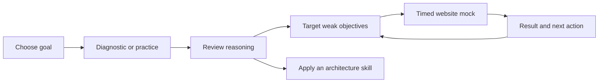
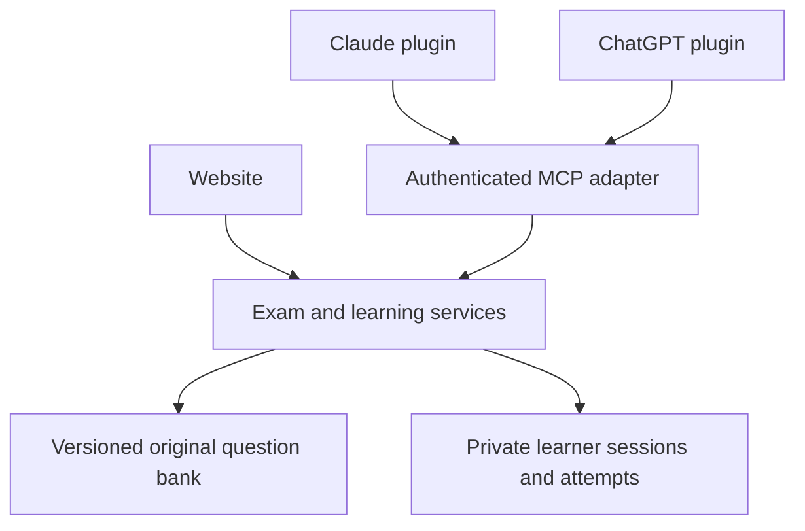

# Mock exam and companion plugins

Status: proposal for discussion, 2026-10-20. This document specifies behavior; it does
not mean the website, MCP service, or plugins have been built.

## Recommended first release

An independent AI architecture trainer with a website for timed exams and a companion
plugin for coaching, short quizzes, and progress review. Keep one exam service and one
learning history across clients. Publish skills and original website material in this
repository; the retained study corpus remains local.

Two choices remain open: general architecture versus Claude certification as the first
public track, and coaching versus full exam-taking as the first chat integration. The
defaults below propose architecture first and a coaching companion.

## Learner experience

| Mode | Proposed first format | Feedback | Purpose |
| --- | --- | --- | --- |
| Diagnostic | 12 questions, untimed, optional confidence rating | After the set | Choose a starting point; show limited evidence explicitly |
| Practice | 5, 10, or 20 questions; filter by topic or weak objectives | After submitting each answer | Learn a distinction, then try a different scenario |
| Mock exam | Initially 30 unique questions in 45 minutes | After final submission or expiry | Practise independent decisions under time constraints |

These counts and timing are product proposals. A later certification-specific preset
must use a separately verified, versioned blueprint. Do not invent an official scaled
score or a probability of passing an external certification.

1. **Arrive:** see what the trainer covers, try a short original practice set without
   an account, and browse the architecture skills.
2. **Save progress:** sign in to save cross-device progress. Guest practice uses local
   state initially; guest-to-account history merging is deferred. Replace the retained
   name/PIN system before public learner accounts launch.
3. **Choose a session:** show topic coverage, item count, duration, feedback rules, and
   whether previously seen questions will appear. Show bank limitations before starting.
4. **Take the session:** readable question, single/multiple selection, progress, flag
   for review, question navigator, and explicit answer-save status. On narrow screens,
   keep question text and controls usable without a dense desktop sidebar.
5. **Finish:** confirm submission with an unanswered/flagged count. An expired mock
   closes automatically on the server. Reopening it leads to its result.
6. **Review:** show the raw score, topic breakdown with sample sizes, time used, correct
   reasoning, why each distractor fails, and source links. Report content problems per item.
7. **Continue:** recommend one targeted practice set and one architecture skill or
   practical case. A later retry uses different scenarios where the bank permits it.

For practice, a submitted answer locks and its explanation becomes available. For a
mock, answers remain editable until submission/deadline and no correctness feedback is
returned while it is active. Exact-set grading is proposed for multiple-response items:
all required selections, no extra selections, no negative marking.

## What the questions should test

Use original scenarios about work allocation, workflows and agents, retrieval and tools,
evaluations, reliability, cost/latency tradeoffs, safety, and operational decisions.
Publish the objective map in our own words. A Claude-focused track can be a separate
mapping after its scope and current source documentation have been verified.

Every item needs an objective, the deciding constraint, defensible distractors, an answer,
an explanation, source links, and a version. Do not generate new scored items on demand
inside an active mock. Draft them through chat, validate, review, then release the bank.

The first 30-item mock needs enough reviewed original items to meet every topic quota
without duplication. Start with a 60-item bank as a planning target; if a quota cannot
be met, offer a clearly shorter preset instead of repeating questions within a sitting.
Fresh-sitting percentages and repeated-item results should be distinguishable.

This public repository makes the original bank inspectable. The product is a self-study
trainer; server-side withholding prevents accidental spoilers, not inspection of public
source code. Version and review content to improve learning quality.

## One shared service

Retain useful scoring, selection, and rendering code. Move application rules out of
route handlers into services callable by both Server Actions and MCP handlers. Keep
that seam inside the existing application initially; separate packages are optional.

- Pin the blueprint, question versions, selected item order, option order, grading rule,
  and deadline for each session. An edited bank must not change an older result.
- Use server time and persisted state: `in_progress → submitted | expired | abandoned`.
  Mock time keeps running across refreshes, closed tabs, and device switches.
- Save draft mock choices separately from graded attempts. Finalization records results
  once; expiry and manual submission racing must produce the same single result.
- Authenticate the learner in each adapter. Pass the validated identity into services;
  a model-supplied learner ID never authorizes access.
- Use request IDs for retried mutations and session revisions for conflicting writes.
  A retry returns the original result; a stale conflicting write returns current state.
- Derive progress from attempts. Present sample counts and unseen evidence separately
  from repeated-item success; do not treat two familiar answers as proof of competence.

## Companion plugin behavior

The user can ask: “Give me five questions on evaluations,” “What am I weakest on?”,
“Explain my last mistake,” or “Open a 45-minute mock.” The plugin calls the same service
as the website and can return a session link to continue in the browser.

| Tool proposal | Behavior |
| --- | --- |
| `learning_status` | Own topic performance, evidence counts, next recommendation |
| `start_practice` | Create/resume a bounded practice set; return a safe first question |
| `get_session` | Fetch own session state and permissible question content |
| `submit_answer` | Record a practice answer; return its deterministic grade and explanation |
| `get_review` | Fetch feedback that the session state permits |
| `open_mock` | Create/resume a website mock and return its URL, rules, and deadline |

Initial chat tools support practice answers and mock status/links. They do not expose
live mock explanations or a bulk answer-key tool. Account linking uses the same learner
account as the website, with authorization enforced on each operation.

Use the five existing architecture skills for deeper coaching and practical work. Add
a focused tutoring workflow only if testing shows the tool metadata alone does not
produce the teaching behavior we want. Do not let a tutor rewrite official attempt scores.

## Claude and ChatGPT packaging

**Claude:** a plugin can bundle skills and connectors, with capabilities varying between
chat, Cowork, and Claude Code. Our cross-client baseline should use skills and a remote
MCP connector, avoiding dependencies on local hooks or subagents. A remote connector
needs a publicly reachable service. [Claude plugins](https://support.claude.com/en/articles/13837440-use-plugins-in-claude),
[remote connectors](https://support.claude.com/en/articles/11175166-get-started-with-custom-connectors-using-remote-mcp).

**ChatGPT:** current plugin documentation supports skills, MCP tools, and optional UI.
Use a thin package around the same service and canonical skill files. A component is
optional; begin with useful text/tool results and website links.
[Plugin architecture](https://developers.openai.com/plugins/concepts/plugins),
[MCP server](https://developers.openai.com/plugins/build/mcp-server).

If in-chat question cards improve the tested experience, prototype the MCP Apps UI
standard next. Host compatibility still needs testing; sharing a standard does not
guarantee identical rendering or install behavior.
[MCP Apps UI](https://developers.openai.com/plugins/build/chatgpt-ui#start-with-mcp-apps).

Generate platform manifests and installable bundles from `skills/`; do not maintain
separately edited Claude/ChatGPT skill variants. Include only learner-facing skills in
the learner bundle; keep content-authoring/maintenance capabilities out of its tools.
Personal installation and public directory approval are separate milestones. Verify
current packaging, authentication, and submission requirements again when implementing.
[OpenAI packaging](https://developers.openai.com/plugins/build/plugins).

## Build order and acceptance gates

| Step | Deliverable | Observable exit check |
| --- | --- | --- |
| 1 | Agree first track, mode defaults, and first topic map | One example question and a complete screen-by-screen walkthrough reviewed |
| 2 | Original content slice and working practice | Ten original items; answer → explanation → retry works; source links resolve |
| 3 | Saved learner identity and timed website mock | Refresh/resume/expiry work; no repeated item within a sitting; history is private |
| 4 | Shared services and remote MCP practice | Website-to-chat-to-website handoff preserves the same learner and attempt history |
| 5 | Claude and ChatGPT installable pilots | Fresh install, successful account linking, five representative prompts per client |
| 6 | Public release | Approved bank coverage, preview walkthrough, checked release, stable URLs and rollback |

## Three release success criteria

1. **A reliable sitting:** a 30-question mock retains choices on refresh, enforces its
   server deadline, and produces the same result once despite retries/device changes.
2. **A useful next step:** a completed sitting produces grounded explanations and a
   targeted follow-up; a pilot learner can explain why an initially wrong choice fails
   and answer a different scenario testing the same decision later.
3. **One learning history across clients:** practice begun in Claude or ChatGPT appears
   correctly on the website, with no duplicate attempts or access to another learner.

## Checks that earn the release

- **Content:** schema → source links → independent item review for ambiguity and support
  → pilot feedback → versioned publication. Generated text is a draft until reviewed.
- **Core behavior:** focused tests for exact-set grading, quota selection, immutable
  session versions, deadline races, idempotent finalization, and account isolation.
- **Browser:** mobile/desktop keyboard use, multi-select, unanswered review, refresh,
  resume, expiry, source links, and result history against a personal preview database.
- **Plugin:** correct tools for five representative prompts per client, invalid inputs,
  expired authorization, repeated requests, account isolation, and unavailable service.
- **Operations:** report CI/preview status through chat; log failed operations by request
  ID; release from a checked commit; verify production and retain a rollback target.

CI passed on the existing public foundation commit `8bc28eb` before this proposal.
That verifies the current automated checks and build on CI, not the new product behavior.
Vercel CLI is connected; the website project, personal database, MCP endpoint, and plugin
registrations remain implementation work.
